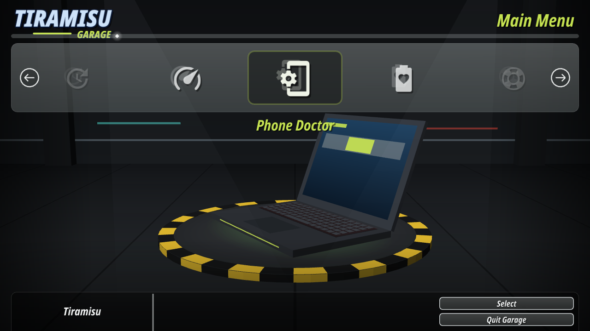
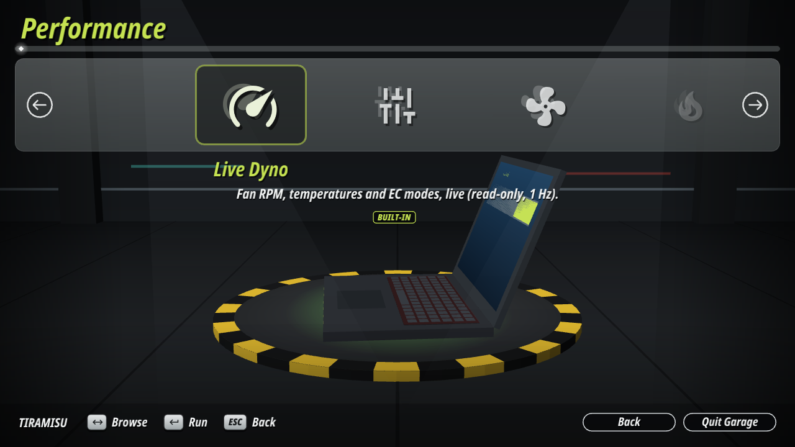
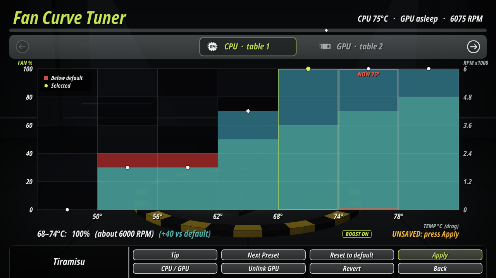
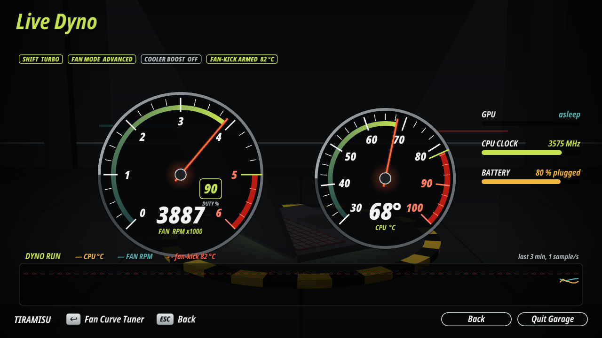
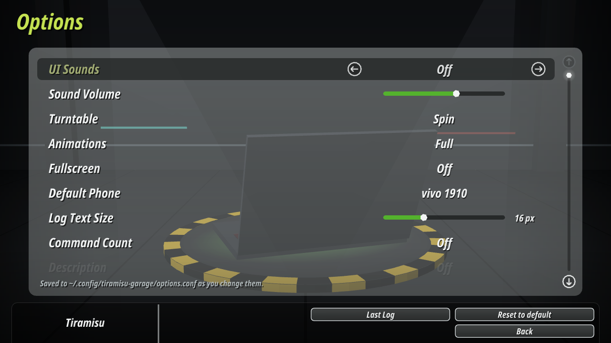

# Tiramisu Garage

One launcher for every workshop script on my laptop, dressed as a 2004
street-racing front end: a translucent icon carousel with a pulsing lime
selection box, a hazard-striped turntable with the laptop as the "hero car",
keycap prompts and "Would you like to…?" dialogs.



It's written in Rust with [macroquad](https://macroquad.rs). Fonts are embedded,
sounds are synthesised at start-up and every icon and shape is drawn at runtime,
so there are no asset files to lose. The look is an homage drawn from scratch and
uses no game assets.

| | |
| --- | --- |
|  |  |
|  |  |

## What's inside

- **Main menu:** one icon per tool (Safe Update, Performance, Phone Doctor,
  Battery Check, Begonia Rescue, Phone Link, Hotspot, Patient Bay, Local AI,
  Media Lab, Paint Shop, Options).
- **Enter on a tool** opens a second carousel with that tool's sub-commands,
  e.g. `safe-update check / post / fix-dkms / after-reboot / …`.
- **Carousel behaviour:** the selection box stays in the centre while the icons
  slide under it. It only moves to the side on the first and last item. Icons
  fade smoothly the further they are from the centre.
- **Fan Curve Tuner (built in):** the "ECU tuning" bar chart for both MSI EC
  fan tables (CPU and GPU). Red means quieter than the MSI factory curve, dark
  teal means louder, and the orange box is the step the fan is on right now.
  Apply writes the EC (only the bytes that differ, then reads them back),
  `~/.config/MControlCenter.conf`, and `/etc/default/msi-ec-profile` (through
  pkexec, only when it differs). Everything goes through MControlCenter's root
  helper on the system bus, so it needs no password.
- **Live Dyno:** fan RPM tachometer, CPU temperature gauge with the fan-kick
  threshold, EC modes and a 3-minute history. It is read-only and samples once
  a second.
- **Footer buttons** like the game's: long rounded bars in a two-row grid that
  fills from the right; they glide to lime over 250 ms on hover, click or hotkey.
  Arrow buttons pop on press and grey out when there is nothing left that way.
- **Options:** the list panel with values: sounds, volume, turntable, animation
  speed, fullscreen, default phone, log text size.

## How commands run

- **Log**: inside the garage. The script gets a real pseudo-terminal through
  util-linux `script`, so colours, `\r` progress lines and `read` prompts behave
  as in a terminal. Type an answer and press Enter to reply to a `[y/N]` prompt.
- **Konsole**: anything that needs `sudo` or is a full TUI.
- **App**: GUI programs, started detached.
- **Built-in**: the tuner, the dyno and the options.

## Keys

| Key | Does |
| --- | --- |
| ← → (A D, mouse wheel) | browse the carousel |
| Enter / Space / click | open / run |
| Esc / Backspace | back (on the main menu: quit) |
| ↑ ↓ | Phone Doctor: pick the phone |
| L | view the running (or last) job's log |
| F11 / F12 | fullscreen / screenshot to `~/Pictures` |

**Tuner:** ← → pick a column, ↑ ↓ ±5 % (Shift ±1 %), `,` `.` move the threshold
at the column's right edge, drag columns or temperature labels with the mouse,
Tab switches CPU/GPU, L link/unlink, P preset, R revert, D factory default,
Enter apply, H help.

**Log screen:** Esc or Ctrl+C stops, PgUp/PgDn scroll, R runs again, C copies the log.

## Build and install

```bash
sh packaging/install.sh
```

That builds the release binary, puts it in `~/.local/bin`, adds **Tiramisu Garage** to
the Start Menu (System), and installs the icon at every size. The window carries the
same icon and the class `tiramisu-garage`, so the taskbar groups it under the menu entry.

It needs Linux with X11 or XWayland, plus `script` (util-linux), `konsole`,
`kdialog`, `busctl` and `pkexec` for the respective features. The Fan Curve
Tuner and the Dyno need [msi-ec](https://github.com/BeardOverflow/msi-ec) and
MControlCenter's helper.

## Make it yours

The tool list is `src/catalog.rs`. Every entry points at one of my own scripts
in `~/.local/bin`, so on another machine you'll want to replace them with yours:

```rust
Tool {
    glyph: g::UPDATE,                  // a Material Design icon from the bundled font
    name: "Safe Update",
    blurb: "Guarded arch-update with pre-flight and post-checks",
    needs: "safe-update",              // dimmed in the menu if this isn't installed
    phone_picker: false,
    cmds: vec![
        c(g::SHIELD_CHECK, "Pre-Flight Check", "Changes nothing.", &["safe-update", "check"], Log),
        c(g::ARCH, "Full Guided Update", "Needs your password.", &["safe-update"], Terminal)
            .confirm("Start the full guided update in Konsole?"),
    ],
},
```

In `argv`, `{}` is the text typed into the ask dialog, `{*}` is that text split
on spaces, and `{files}` is the files picked in the KDE file dialog.

Options live in `~/.config/tiramisu-garage/options.conf`. Optional:
`vivo_serial=…` pins the phone picker's "vivo" entry to one adb serial.
Without it, any adb device whose model says vivo is used.

## Development

```bash
cargo test                                  # terminal model, quoting, EC/conf parsing, tuner maths
GARAGE_DEMO=/tmp/shots cargo run            # drives every screen by itself, saves a PNG at each stop
GARAGE_DEMO=/tmp/shots GARAGE_DEMO_UNTIL=7 cargo run   # stop early
```

The demo never applies a fan curve. Its tuner edit lives only in memory.

| File | What |
| --- | --- |
| `src/main.rs` | screens, transitions, input, dialogs, demo |
| `src/draw.rs` | virtual-canvas drawing kit (rounded panels, circle arrows, keycaps) |
| `src/scene.rs` | the 3D garage backdrop |
| `src/tuner.rs`, `src/ec.rs` | the fan curve tuner and the EC / config-file access |
| `src/dyno.rs` | telemetry thread and gauges |
| `src/term.rs` | small terminal model for job output |
| `src/runner.rs` | running jobs (pty), Konsole, detached apps, file picker |
| `src/sound.rs` | menu sounds synthesised at start-up |

Bundled font licences are in [`assets/licenses`](assets/licenses).
